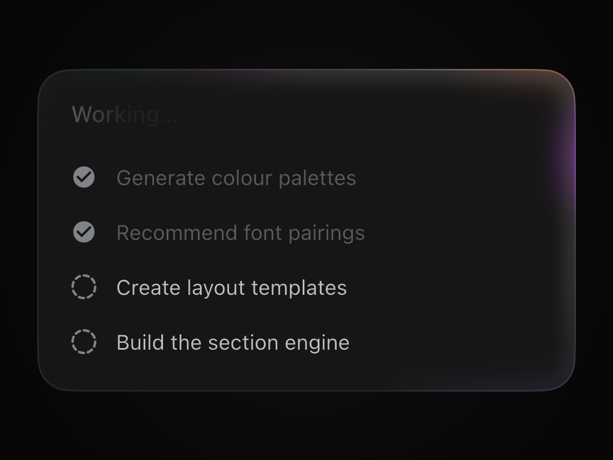
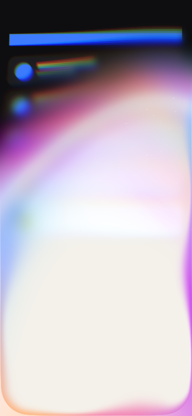
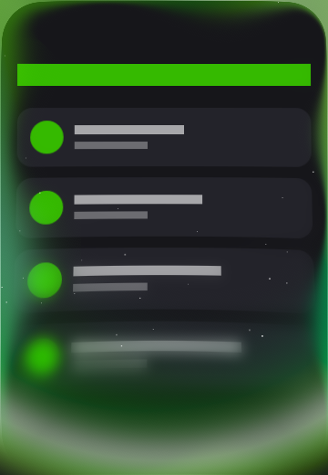
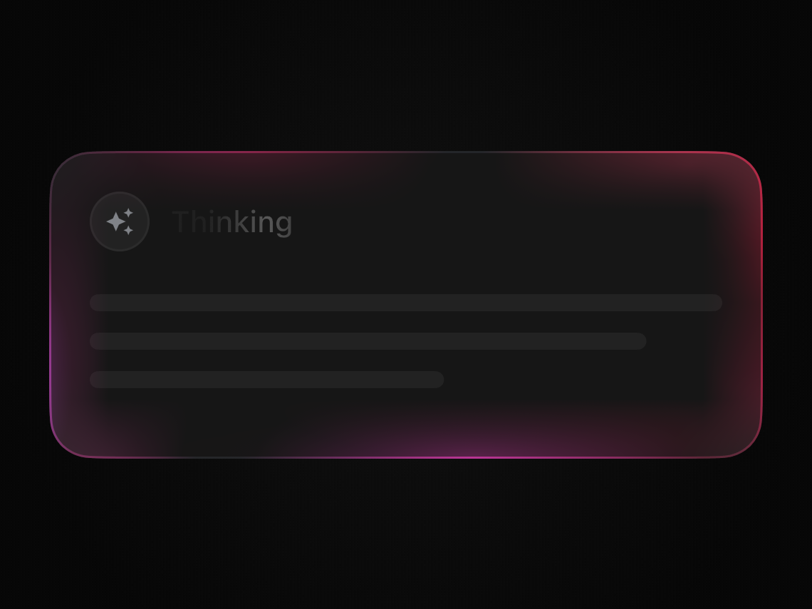
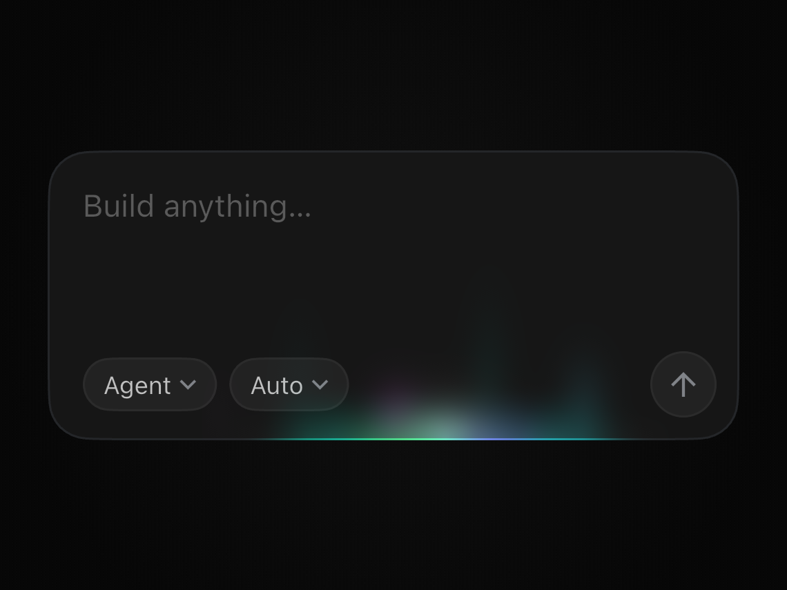
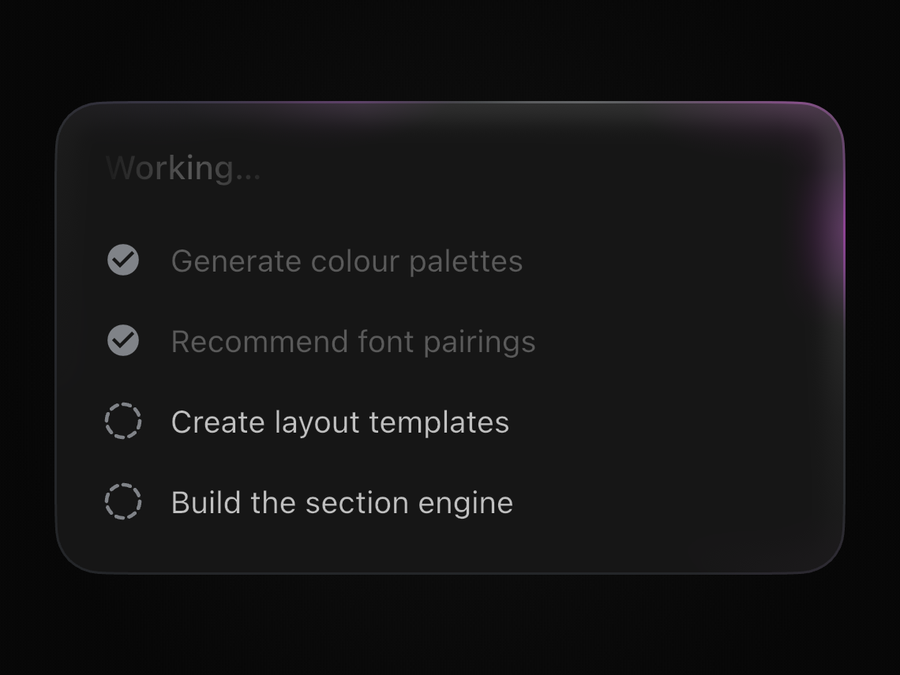

<div align="center">
  <h1><b>prismatic</b></h1>
  <p>
    Shader-driven light and motion for Flutter: a beam of light around any border,<br/>and a refractive wave that carries one screen into another.
  </p>
</div>

<p align="center">
  <a href="https://pub.dev/packages/prismatic"></a>
  <a href="https://pub.dev/packages/prismatic/score"></a>
  <a href="https://docs.flutter.dev"></a>
  <a href="https://dart.dev"></a>
  <a href="https://github.com/SimplifyJobs/prismatic/actions/workflows/ci.yaml"></a>
  <a href="https://codecov.io/gh/SimplifyJobs/prismatic"></a>
  <a href="LICENSE"></a>
</p>

<div align="center">
  
</div>


## Overview

`prismatic` is a home for shader effects that feel native on Flutter's Impeller renderer. Each is drawn by a fragment shader written for it, with the work per frame kept to a draw or two.

| Effect | What it does | Use it for |
| --- | --- | --- |
| [`BorderBeam`](#borderbeam) | Light that travels or breathes around a widget's border: three effects, 19 palettes, squircle corners, theming. One shader, one draw per frame. | Cards, inputs, search bars, focus and "thinking" states. |
| [`DistortionWave`](#distortionwave) | A colourful, refractive wave that opens from a button, an edge or an avatar and carries one view into another, with a progressive blur, colour fringing and colour lingering on the view's edges. One shader draw (plus one for its sparks) per frame. | Confirming a payment, sending, going to the next step, a success state; between routes. |

<table>
  <tr>
    <td width="33%" align="center">
      <br/>
      <sub><b>BorderBeam</b> — a beam laps a card's border</sub>
    </td>
    <td width="33%" align="center">
      <br/>
      <sub><b>DistortionWave</b> — the front crossing a screen</sub>
    </td>
    <td width="33%" align="center">
      <br/>
      <sub><b>DistortionWave</b> — a ring from an avatar</sub>
    </td>
  </tr>
</table>

### Live demo

**<https://simplifyjobs.github.io/prismatic/>** — the example app built for web: each effect on the kind of widget it is made for, recoloured with any preset, in either theme. Built from [`example/`](example).


## Installation

```console
flutter pub add prismatic
```

```dart
import 'package:prismatic/prismatic.dart';        // everything
import 'package:prismatic/border_beam.dart';      // or one effect alone
import 'package:prismatic/distortion_wave.dart';
```

| Requirement | Version |
| --- | --- |
| Flutter | ≥ 3.47 |
| Dart | ≥ 3.13 |
| Dependencies | [`material_ui`](https://pub.dev/packages/material_ui) |

The shaders are declared in the package's own `pubspec.yaml`, so Flutter compiles and bundles them into your app. There is nothing to add to your app's pubspec.

The package reads Material through [`material_ui`](https://pub.dev/packages/material_ui), not the `package:flutter/material.dart` that Flutter 3.47 deprecated. The two libraries' `Theme` and `ColorScheme` are separate types, so an app still on `package:flutter/material.dart` should migrate (`dart fix --apply --code=migrate_design_widgets`) or set `BeamStyle.theme` explicitly: until then, `BeamTheme.auto` finds no `material_ui` theme and tunes for a light surface, and `BeamColors.fromScheme` takes `material_ui`'s `ColorScheme`.


## BorderBeam

`BorderBeam` draws light that travels or breathes around a widget's border. Wrap a widget in `BorderBeam`, pick an effect, and the beam paints over it — matched to its corner radius, adapted to a dark or light surface, and animated by one ticker.

The whole beam is **one fragment shader drawn in one pass**: no `saveLayer`, no blur filters, no clips, and no offscreen render targets. It runs at the display's refresh rate, 120Hz included, and is cheap enough to leave on a card while the user scrolls.

**Three effects**, chosen with `effect:`:

| Effect | Family | Default cycle | Use it for |
| --- | --- | --- | --- |
| `BeamEffect.rotate()` | travelling | 2.4s | A beam with a soft tail laps the border. Cards, panels, surfaces. The default. |
| `BeamEffect.line()` | travelling | 3.1s | A streak rides one edge with light spiking up from it. Inputs, search bars, composers. |
| `BeamEffect.pulse()` | ambient | 2.3s | Colour breathes inward from the whole border, strongest at the corners. A contained "thinking" state. |

<table>
  <tr>
    <td width="50%" align="center">
      <br/>
      <sub><b>rotate</b> — a beam laps the border</sub>
    </td>
    <td width="50%" align="center">
      <br/>
      <sub><b>pulse</b> — colour breathes in from the border</sub>
    </td>
  </tr>
  <tr>
    <td width="50%" align="center">
      <br/>
      <sub><b>line</b> — a streak rides the bottom edge</sub>
    </td>
    <td width="50%" align="center">
      <br/>
      <sub><b>superellipse</b> corners, <code>ocean</code> palette</sub>
    </td>
  </tr>
</table>

Around the effects:

- **19 palettes** plus your own: colour stops anywhere on the ring, `fromSeed` harmonies, `fromScheme`, `lerp`, and `scaleAlpha`.
- **Value-object API** — `BeamStyle`, `BeamShape`, `BeamTiming`, `BeamPlayback`. Every field is nullable, so anything you leave out comes from a `BorderBeamTheme` or the effect's default.
- **Shapes** — per-corner, direction-aware radii, stadiums, superellipse ("squircle") corners, ring offset, partial segments, and dashes.
- **Motion** — rest between sweeps, forward / reverse / bounce, phase offset, several beams at once, a driven `progress`, and pointer `follow`.
- **Synchronized groups** — `BeamSync` puts a subtree on one ticker and one timeline.
- **Surfaces and interactions** — `BorderBeam.overlay`, `BeamDecoration` for an existing `Container`, and `BeamFocusRing` / `BeamHover` / `BeamPress`.
- **Accessible** — four reduced-motion behaviours; beams add no semantics and never intercept a pointer.

### Quick start

```dart
BorderBeam(
  borderRadius: 16,
  colors: BeamColors.ocean,
  child: Card(
    shape: RoundedRectangleBorder(borderRadius: BorderRadius.circular(16)),
    child: const Padding(
      padding: EdgeInsets.all(24),
      child: Text('Working on it…'),
    ),
  ),
)
```

That is a rotating beam — `BeamEffect.rotate()` is the default effect. Pass the same radius your child uses; the beam does not read it from the child.

Everything else is a field on one of four value objects — `style`, `shape`, `timing`, `playback` — and every field on them is nullable, meaning *inherit*:

```dart
BorderBeam(
  effect: const BeamEffect.line(),
  style: const BeamStyle(colors: BeamColors.sunset, strength: 0.8),
  shape: const BeamShape.all(24, superellipse: true),
  timing: const BeamTiming(cycleGap: Duration(seconds: 1)),
  playback: const BeamPlayback(reducedMotion: BeamReducedMotion.staticFrame),
  child: card,
)
```

Optionally load the shader before the first beam appears:

```dart
Future<void> main() async {
  WidgetsFlutterBinding.ensureInitialized();
  await BorderBeam.precache();
  runApp(const App());
}
```

Without it, a beam loads the shader on demand and paints nothing for the few milliseconds that takes, which its fade-in hides.

### Effects

```dart
BorderBeam(effect: const BeamEffect.rotate(), child: card);
BorderBeam(effect: const BeamEffect.rotate(length: 1.5, count: 2, comet: true), child: card);
BorderBeam(effect: const BeamEffect.line(edge: BeamEdge.top), child: searchBar);
BorderBeam(effect: const BeamEffect.pulse(), child: card);
```

| Effect | Parameters | Default hue drift |
| --- | --- | --- |
| `rotate` | `length` (tail, 0.25–2, default 1), `count` (1–4 beams, default 1), `comet` (outer trailing glow, default false) | ping-pong, 12s |
| `line` | `edge` (default `BeamEdge.bottom`) | ping-pong, 8s |
| `pulse` | — | continuous, 16s |

The two families take different inputs. **Travelling** effects (`rotate`, `line`) move a position along the border once per cycle; they respond to `direction`, `cycleGap`, `progress`, and `follow`. The **ambient** `pulse` lights the whole border at once and ignores those inputs. `phaseOffset` applies to both families.

Every effect is drawn by the same shader in the same single draw, so they cost the same order of GPU time. Pick for the look.

`BeamEffect.values` lists all three with their defaults, and each effect is a value type, so `BorderBeam(effect: someEffect)` picked at runtime needs no switch.

[Full documentation →](doc/effects.md)

### Palettes

```dart
// A preset
BorderBeam(colors: BeamColors.aurora, child: card);

// Your own colours, evenly spaced clockwise from top-centre
BorderBeam(
  colors: const BeamColors([Colors.pink, Colors.cyan, Colors.amber]),
  child: card,
);

// …or placed at chosen positions around the ring
BorderBeam(
  colors: const BeamColors(
    [Colors.indigo, Colors.pink, Colors.orange],
    stops: [0.0, 0.4, 0.7],
  ),
  child: card,
);

// One colour all the way round
BorderBeam(colors: const BeamColors.solid(Color(0xFF18A8F0)), child: card);

// One brand colour, spread into a harmony
BorderBeam(
  colors: const BeamColors.fromSeed(
    Color(0xFF18A8F0),
    harmony: BeamSeedHarmony.triadic,
  ),
  child: card,
);

// The app's Material scheme
BorderBeam(
  colors: BeamColors.fromScheme(Theme.of(context).colorScheme),
  child: card,
);

// Blend two palettes, and dim one
BorderBeam(
  colors: const BeamColors.lerp(BeamColors.ocean, BeamColors.sunset, 0.35),
  child: card,
);
BorderBeam(colors: BeamColors.ember.scaleAlpha(0.6), child: card);
```

A palette is a ring of 1–8 colour stops around the border: position 0 is top-centre and positions increase clockwise. Neighbouring stops blend, and the last blends back into the first. `rotate` and `pulse` reveal the colours wherever their light falls; `line` spreads the palette across its streak.

| Preset | Colours | Notes |
| --- | --- | --- |
| `colorful` | orange, magenta, violet, blue, green, hot pink | the default |
| `mono` | whites and greys | hue never drifts |
| `ocean` | blues and violets | |
| `sunset` | reds, oranges, amber | |
| `aurora` | teal, violet, green | |
| `neon` | magenta, lime, cyan | the loudest |
| `candy` | pastel pink, lavender, peach | |
| `ember` | deep red, orange, gold | |
| `ice` | pale blue, white, cyan | |
| `gold` | amber, gold, bronze | hue never drifts |
| `holographic` | desaturated pastels | pair with a fast continuous hue drift |
| `lagoon` | teal, aqua, mint | |
| `dusk` | indigo, violet, rose | |
| `forest` | emerald, lime, teal | |
| `rose` | pink, coral, mauve | |
| `cosmic` | deep violet, electric blue, magenta | |
| `citrus` | lime, yellow, tangerine | |
| `sky` | cerulean, periwinkle, white-blue | |
| `lavender` | lilac, lavender, soft pink | |

`BeamColors.presets` maps every preset's name to its value, in this order. Every `BeamColors` is a value type and resolution is memoized by value in a bounded LRU, so building `BeamColors([...])` inline in `build` costs nothing after the first frame; an app that cycles through more distinct palettes than the memo holds rebuilds an evicted one when it comes back.

[Full documentation →](doc/palettes.md)

### Shape

```dart
// Uniform radius, const
BorderBeam(shape: const BeamShape.all(24, superellipse: true), child: card);

// Per-corner, direction-aware
BorderBeam(
  shape: const BeamShape(
    radius: BorderRadiusDirectional.only(topStart: Radius.circular(28)),
  ),
  child: card,
);

// A pill (a circle on a square box) that tracks the box as it resizes
BorderBeam(shape: const BeamShape.stadium(), child: chip);

// The outline 8px outside the child, with a 2px stroke
BorderBeam(
  shape: const BeamShape.all(24, ringOffset: 8, borderWidth: 2),
  child: card,
);
```

`BeamShape.all(r)` is the **const** path to a uniform radius, `BeamShape.circular(r)` builds the same shape from a `BorderRadius` (not const), and `BeamShape.stadium()` rounds each corner to half the shortest side. `radius` resolves against the ambient `Directionality` and is clamped per corner the way `RRect.scaleRadii` does. `superellipse: true` follows Flutter's `RoundedSuperellipseBorder`, so the stroke sits on the edge of a squircle-clipped child.

The default radius is 16. There is **no auto-detection of the child's radius** — pass the value your child uses.

[Full documentation →](doc/shape.md)

### Segments and dashes

`BeamShape.segment` limits the light to a clockwise portion of the border. The animation runs unchanged on the whole border; the segment shows the part inside it and fades its ends over `feather` logical pixels (32 by default).

```dart
BorderBeam(
  shape: const BeamShape(
    radius: BorderRadius.all(Radius.circular(24)),
    segment: BeamSegment.bottomHalf,
  ),
  child: square,
);
```

Positions are arc-length fractions from top-centre, clockwise. Build endpoints with `BeamAnchor.fraction(t)`, `BeamAnchor.edge(edge, t)`, or `BeamAnchor.corner(corner, t)`, or use `BeamAnchor.topCenter` / `rightCenter` / `bottomCenter` / `leftCenter`. `BeamSegment(start: …, end: …, feather: 32)` runs clockwise from `start` to `end`, wrapping through top-centre when needed; `feather: 0` makes a hard cut.

| Preset | Coverage |
| --- | --- |
| `bottomHalf` / `topHalf` | The lower / upper half between the side centres |
| `leftHalf` / `rightHalf` | The left / right half between the top and bottom centres |
| `bottomEdge` / `topEdge` / `leftEdge` / `rightEdge` | The named straight run plus both adjacent corner curves |

`rotate` appears at `start` and travels to `end`; `line` rides the segment instead of its `edge`, around corners included; the ambient effects light only the part inside it.

`BeamShape.dashes` breaks the border into that many evenly spaced dashes (2 or more; 0 and 1 keep it solid):

```dart
BorderBeam(
  shape: const BeamShape.all(16, dashes: 12),
  child: badge,
);
```

### Style

```dart
BorderBeam(
  style: const BeamStyle(
    colors: BeamColors.aurora,
    theme: BeamTheme.dark,
    strength: 0.8,
    glow: 1.3,
    hueMode: BeamHueMode.continuous,
    hueBase: 40,
  ),
  child: card,
);
```

| Field | Meaning |
| --- | --- |
| `colors` | The palette. |
| `theme` | `dark`, `light`, or `auto` (follows `material_ui`'s `Theme.of(context).brightness`). Each effect is tuned separately for dark and light surfaces. |
| `strength` | Overall opacity, 0–1. |
| `glow` | Scales every glow around the stroke: how far it reaches and, below 1, how bright it is; 0 leaves only the stroke, which `glow` never changes. |
| `hueMode` | How the colours drift: `pingPong` (swing ±`hueShift`), `continuous` (a full turn per `huePeriod`), or `none`. Defaults per effect. |
| `hueShift` | Degrees either side for `pingPong`. |
| `hueBase` | A fixed hue rotation, in degrees, on top of any drift. |

`mono` and `gold` never drift, whatever `hueMode` says.

### Motion

```dart
BorderBeam(
  effect: const BeamEffect.rotate(count: 3),
  timing: const BeamTiming(
    cycle: Duration(seconds: 3),      // one lap
    cycleGap: Duration(seconds: 1),   // rest between laps
    direction: BeamDirection.bounce,  // alternate each cycle
    phaseOffset: 0.25,                // start a quarter of the way in
    speed: 1.5,                       // playback rate
    huePeriod: Duration(seconds: 8),  // colour drift period
  ),
  child: card,
);
```

Changing `cycle` while the beam runs **retimes it in place** — the beam keeps its position and speeds up or slows down without a jump. `cycleGap` parks a travelling effect at the end of its travel after each sweep and fades it out and back in over `min(0.25s, gap / 2)` at each end; the hue drift keeps running through the gap.

[Full documentation →](doc/motion.md)

### Playback

```dart
BorderBeam(
  effect: const BeamEffect.pulse(),
  active: isLoading,                          // fades in ~0.5s / out ~0.6s
  playback: const BeamPlayback(
    startAfter: Duration(milliseconds: 500),
    duration: Duration(seconds: 10),
    repeat: BeamRepeat.count(3),
    reducedMotion: BeamReducedMotion.staticFrame,
  ),
  onActivate: () => debugPrint('visible'),    // when the fade-in completes
  onDeactivate: () => debugPrint('hidden'),
  child: card,
);
```

| `BeamReducedMotion` | Behaviour |
| --- | --- |
| `staticFrame` | Paints one static frame and stops ticking. **The default.** |
| `hide` | Paints nothing; the child is left bare and no ticker runs. |
| `slow` | Keeps animating at a quarter of the configured speed. |
| `animate` | Ignores the request. |

`pauseWhenOffscreen` (default on) stops a beam's clock while it is scrolled more than 256px out of its nearest `Scrollable`, and resumes it where it left off. `fadeCurve` replaces the critically damped springs that ease the fades. `debugFrozenAt` pins the beam to one instant of its timeline — for screenshots and golden tests, not product code.


### Advanced

#### Theming

```dart
BorderBeamTheme(
  data: const BorderBeamThemeData(
    effect: BeamEffect.pulse(),
    style: BeamStyle(colors: BeamColors.ocean, strength: 0.8),
    shape: BeamShape.all(20, superellipse: true),
    timing: BeamTiming(cycle: Duration(seconds: 3)),
    playback: BeamPlayback(reducedMotion: BeamReducedMotion.slow),
  ),
  child: MaterialApp(home: home),
);
```

`BorderBeamThemeData` has a slot for the effect and one per value object; each object's fields are nullable, so a theme fills in only what it sets. `BorderBeamTheme.of` walks **every** enclosing theme and merges them outside-in, so an inner theme overrides only the fields it names.

[Full documentation →](doc/theming.md)

#### Controller

A `BorderBeamController` takes **full ownership** of playback: `playback.startAfter` and `playback.duration` must not be set (on the widget or a theme — it is asserted), `active` and `autoPlay` are ignored, the controller's `speed` replaces `timing.speed`, and the beam starts hidden until you call `start()`.

```dart
final controller = BorderBeamController();

BorderBeam(controller: controller, child: card);

controller.start();                      // fade in, play (or resume if paused)
controller.pause();                      // freeze the current frame
controller.resume();
controller.speed = 2;                    // playback rate; must be positive
controller.seek(const Duration(seconds: 1));
controller.pulse();                      // one brightness bump, ~0.6s settle
controller.flash();                      // a sharper blink, hold 120ms, decay
controller.stop();                       // fade out, halt
```

`speed` and `seek` move the animation, never a fade or an accent, which run in real time; a `speedListenable` still wins over the controller's rate, and reduced motion's `slow` still quarters it. `isAttached`, `isActive`, and `isRunning` report state, and the controller is a `ChangeNotifier`. **One controller drives one beam** at a time; handing it to another beam in the same frame is fine. A beam under a `BeamSync` runs on the group's clock and cannot also take a controller.

#### Driving the beam yourself

```dart
// A glowing progress ring; with BeamEffect.line() a progress bar.
BorderBeam(progress: downloaded / total, child: card);

// The sweep gravitates to a point in the box (normalized 0–1).
BorderBeam(follow: const Offset(0.5, 0.2), child: card);

// Live opacity and rate, without rebuilding.
BorderBeam(
  strengthListenable: micLevel, // ValueListenable<double>
  speedListenable: tempo,       // ValueListenable<double>, positive
  child: card,
);
```

| Input | Type | What it does |
| --- | --- | --- |
| `progress` | `double?` (0–1) | Places the travel instead of the clock: `rotate` becomes a progress ring, `line` a progress bar. The clock keeps running underneath, so the fade and hue stay alive. Cheap to drive every frame. |
| `follow` | `Offset?` (normalized) | Eases the travel to the border point nearest a point in the box — critically damped, about 150ms. Null hands it back to the clock without a snap, keeping the direction it was travelling. `progress` wins over it. |
| `strengthListenable` | `ValueListenable<double>?` | Scales the beam's opacity each frame, without a rebuild. |
| `speedListenable` | `ValueListenable<double>?` | Sets the playback rate each frame; wins over `timing.speed` and a controller's rate. |

Ambient effects ignore `progress` and `follow`. `BeamHover` wires `follow` to the mouse for you.

#### Synchronized groups

Each beam owns its own ticker, so beams started at different moments drift apart. `BeamSync` gives a subtree **one clock** — one ticker, one timeline, identical phases:

```dart
BeamSync(
  child: Row(
    children: [
      for (final (i, card) in cards.indexed)
        BorderBeam(
          timing: BeamTiming(phaseOffset: i / cards.length),
          child: card,
        ),
    ],
  ),
);
```

Effect, palette, shape, and `phaseOffset` stay per beam, but **the group owns playback**: `active`, `autoPlay`, `startAfter`, `duration`, `repeat`, `fadeCurve`, `pauseWhenOffscreen`, and `timing.speed` are ignored below a `BeamSync`. Use its own `active`, `speed`, and `reducedMotion` instead. A member that changes its `cycle` retimes only itself.

#### Overlay and decoration

`BorderBeam.overlay` is a beam with no child of its own, sized by its parent:

```dart
Stack(
  children: [
    content,
    const Positioned.fill(child: BorderBeam.overlay(borderRadius: 16)),
  ],
);
```

`BeamDecoration` is the same renderer as a `Decoration`, for a `Container` you already have. Put it in `foregroundDecoration:` so it paints over the child, as `BorderBeam` does:

```dart
Container(
  foregroundDecoration: BeamDecoration(
    effect: const BeamEffect.rotate(),
    brightness: Theme.of(context).brightness,
    theme: BorderBeamTheme.of(context),
    colors: BeamColors.ocean,
    borderRadius: 16,
  ),
  decoration: BoxDecoration(
    color: surface,
    borderRadius: BorderRadius.circular(16),
  ),
  child: content,
);
```

A `BoxPainter` has no `BuildContext`, so the decoration form gives up four things the widget has: ambient theming is passed in (`brightness` is required, `theme:` takes `BorderBeamTheme.of(context)`); its ticker is not muted by `TickerMode`; reduced motion and `pauseWhenOffscreen` are not observed; and `active` is a starting state, not a toggle. Prefer `BorderBeam` when any of those matter.

#### Interaction wrappers

```dart
BeamFocusRing(borderRadius: 12, child: TextField(decoration: decoration));
BeamHover(borderRadius: 20, child: pricingCard);
BeamPress(borderRadius: 20, onTap: submit, child: card);
```

| Widget | Lights when | Default effect | Notable options |
| --- | --- | --- | --- |
| `BeamFocusRing` | `child`'s subtree (or `focusNode`) holds focus | `rotate` (compact on small controls), `ocean` palette unless `style` or a theme sets colours | `alwaysShow` lights it under touch focus too |
| `BeamHover` | the cursor is over `child`, pulling the travel toward it | `rotate` | `followPointer`, `holdAfterExit` (300ms) |
| `BeamPress` | a finger is down on `child` | `pulse` | `minimumDuration` (600ms), `onTap` |

Each flips `BorderBeam`'s `active` (and `BeamHover` feeds `follow`), so transitions use the beam's own fades, and each passes `effect`, `style`, `shape`, and `timing` through. `BeamPress` listens through a translucent `Listener` and never enters the gesture arena, so buttons inside keep their taps and scrollables above keep their drags.


### Reference

Every field is nullable and null means *inherit*; the defaults below are what you get when nothing sets a field.

#### `BeamStyle`

| Field | Type | Default |
| --- | --- | --- |
| `colors` | `BeamColors?` | `BeamColors.colorful` |
| `theme` | `BeamTheme?` | `BeamTheme.auto` |
| `strength` | `double?` | `1` (clamped 0–1) |
| `glow` | `double?` | `1` (must not be negative) |
| `hueMode` | `BeamHueMode?` | per effect (see [Effects](#effects)) |
| `hueShift` | `double?` | `30` |
| `hueBase` | `double?` | `0` |

#### `BeamShape`

| Field | Type | Default |
| --- | --- | --- |
| `radius` | `BorderRadiusGeometry?` | 16 on every corner |
| `superellipse` | `bool?` | `false` |
| `borderWidth` | `double?` | `1` |
| `ringOffset` | `double?` | `0` |
| `segment` | `BeamSegment?` | the whole border |
| `dashes` | `int?` | `0` (solid) |

#### `BeamTiming`

| Field | Type | Default |
| --- | --- | --- |
| `cycle` | `Duration?` | per effect (see [Overview](#overview)) |
| `cycleGap` | `Duration?` | zero; travelling effects only |
| `speed` | `double?` | `1` (a controller's `speed` replaces it; the fades always run in real time) |
| `direction` | `BeamDirection?` | `forward` |
| `phaseOffset` | `double?` | `0` (fraction of a cycle, 0–1) |
| `huePeriod` | `Duration?` | per effect (see [Effects](#effects)) |

#### `BeamPlayback`

| Field | Type | Default | Meaning |
| --- | --- | --- | --- |
| `active` | `bool?` | `true` | Play state. Toggling fades in (~0.5s) / out (~0.6s). |
| `autoPlay` | `bool?` | `true` | Whether the beam starts by itself. |
| `startAfter` | `Duration?` | none | Delay before autoplay. Must be null with a controller. |
| `duration` | `Duration?` | none | Total play time before the beam fades out by itself. Must be null with a controller. |
| `repeat` | `BeamRepeat?` | `forever()` | `forever()`, `once()`, or `count(n)` cycles, then a fade-out. |
| `reducedMotion` | `BeamReducedMotion?` | `staticFrame` | What to do when the platform asks for reduced motion. |
| `pauseWhenOffscreen` | `bool?` | `true` | Stop the clock while scrolled out of view (256px margin). |
| `fadeCurve` | `Curve?` | critically damped springs | The easing of both fades. `BeamPlayback.cssEase` is the web's `ease`. |
| `debugFrozenAt` | `Duration?` | none | Pin the beam to one instant and never start its clock. |

#### Shorthands and precedence

`colors`, `active`, and `borderRadius` sit directly on the widget as shorthands for `style.colors`, `playback.active`, and a uniform `shape.radius`. A field resolves in one order:

```text
shorthand  >  value object on the widget  >  BorderBeamTheme (inner over outer)  >  effect default
```


## DistortionWave

A colourful, refractive wave that opens from the widget that started it — a button, a screen edge, an avatar — and carries one view into another. Everything falls toward the source for a moment, tiny white sparks with it. Then the front leaves the source as one soft swell, lifting and bending what it passes, with a progressive blur and colour fringing peaking on it. Its colour stays on the view's edges, with a hairline on the glass, after the middle has cleared.

It reimplements the look of Jakub Antalik's [Distortion waves](https://github.com/Jakubantalik/Libraries.dev/tree/main/packages/distortion-waves) (SwiftUI) for Flutter, with a renderer of its own: both views are drawn from GPU pictures of themselves by **one fragment shader in one draw**, with no `saveLayer`, `BackdropFilter` or `ImageFilter` per frame. It runs on Impeller, Skia and the web alike.

### Quick start

Flip `revealed` to send the wave out; flip it back to collapse it into its source. A `DistortionWaveAnchor` around the button gives the wave its source and the touch it leans toward — no geometry plumbing:

```dart
DistortionWave(
  revealed: sent,
  revealedChild: const ReceiptScreen(),
  child: ReviewScreen(
    send: DistortionWaveAnchor(
      child: FilledButton(
        onPressed: () => setState(() => sent = true),
        child: const Text('Send'),
      ),
    ),
  ),
)
```

Give both views an opaque background. `await DistortionWave.precache()` in `main()` loads the shaders and has the GPU build their pipelines ahead of the first wave.

### Between routes

`DistortionWaveRoute` plays the wave from the button that pushed it into the new page, and collapses it back on pop:

```dart
FilledButton(
  onPressed: () => Navigator.of(context).push(
    DistortionWaveRoute<void>(
      source: WaveSource.of(context),
      builder: (context) => const ReceiptScreen(),
    ),
  ),
  child: const Text('Send'),
)
```

Inside a `DistortionWaveAnchor`, `WaveSource.of(context)` carries the touch too.

### Types

| `type:` | From | Use it for |
| --- | --- | --- |
| `WaveType.vertical` (default) | a wide source at the bottom, up the view | confirming a payment, sending, submitting |
| `WaveType.horizontal` | a tall source at the left, across the view | an edge swipe, a side tab, going on to the next step |
| `WaveType.center` | the centre of a round source, as a ring | a success on an avatar or icon, inside a sheet or card |

Each type comes with its own tuned defaults. `center` is tuned for a sheet about 500 pt tall, in greens, and leaves its source sharp and in place, so the avatar can change in plain view while the ring spreads from it. The vertical and horizontal waves lean toward where the source was touched (`WaveMotion.orientation`).

### Palettes

`palette:` takes `WavePalette.colorful` (the default), `green`, `ocean`, `sunset`, `mono`, `WavePalette.single(color)`, or any border-beam palette through `WavePalette.fromBeamColors(BeamColors.aurora)`. The colours flow along the front and round the edges, with a fringe riding ahead of the front and one trailing behind it, mixed in OKLab so neighbours never pass through grey.

### Style

Everything else is a `WaveStyle`, grouped the way you tune it. Every field is nullable: what you leave out comes from the nearest `DistortionWaveTheme`, then from the type's tuned defaults.

| Group | Fields |
| --- | --- |
| `WaveTiming` | `anticipation`, `travel`, `easing`, `returnSpeed`, `linger`, `rimFade`, `rimEasing`, `hairlineLinger`, `hairlineFade` |
| `WaveMotion` | `pull`, `inhale`, `gatherGlow`, `gatherDots`, `launchGap`, `orientation` |
| `WaveLens` | `amplitude`, `width`, `aberration`, `swell`, `blur`, `blurAhead`, `blurBehind` |
| `WaveGlow` | `lead`, `tail`, `strength`, `rimWidth`, `rimUnevenness`, `rimStrength`, `rimSoftness`, `rimPulse`, `hairlineWidth`, `hairlineOpacity`, `hairlineWhite`, `cornerRadius` |
| `WaveDots` | `count`, `size`, `reach`, `flight`, `gap`, `life`, `spread` |

```dart
DistortionWave(
  type: WaveType.center,
  style: const WaveStyle(
    palette: WavePalette.ocean,
    glow: WaveGlow(cornerRadius: 32), // the corners of the view the wave fills
    lens: WaveLens(aberration: 0),    // no colour fringing
  ),
  revealedChild: done,
  child: sheet,
)
```

Set `WaveGlow.cornerRadius` to the corners of the view the wave fills — a phone's screen, or a sheet's — so the colour on the edges and its hairline sit on them. The corners are Flutter's rounded superellipse, as a phone's screen is.

### Control

- **`DistortionWaveController`** — `reveal({source})`, `collapse({source})`, `toggle()`, `seek(progress)`. Attached, it owns playback and `revealed` is ignored.
- **`progress:`** — holds the wave at any point of its life, 0–1, for screenshots, tests, or driving it from a gesture; set it back to null and the wave plays on from there.
- **`onFinish`** — called when a run arrives (not when it is interrupted by another).
- **`source:`** — `WaveSource.rect(rect, focus:)`, `WaveSource.key(globalKey)` or `WaveSource.of(context)`; by default the anchor pressed last, or the usual spot for the type.
- **`maintainState`** — the hidden view stays mounted, with its tickers muted (default), or is built only while the wave runs.
- **`DistortionWaveTheme`** — defaults for every wave and wave route below it.

### How it renders

At rest, the visible view is drawn as itself and the wave adds nothing. While the wave bends content, each view is pictured to a GPU image — when the wave first needs it, and again only when that view repaints — with two small blurred copies baked from it once. One fragment shader then draws the frame: the swell, the progressive blur (mixed from the sharp picture and its blurred copies by the radius each pixel should have), the crossfade at the front, five-tap colour fringing along the displacement, and the band, rim and hairline over them. The sparks are one `drawRawAtlas`. Once the front has crossed and bends nothing, the revealed view is drawn as itself again, with only the lingering colour drawn over it.

- **Content inside a nested `RepaintBoundary`** (a list item, a spinner wrapped in one) repaints without the wave hearing of it, so it holds still for the second or so the wave bends it. Pass `snapshots: WaveSnapshots.everyFrame` to picture both views every frame instead.
- **A view holding a platform view** (a map, a web view) cannot be pictured; the wave crossfades for that run.
- **Reduced motion** makes it a 0.3 s crossfade.

[How it is built →](doc/distortion_wave.md)


## Accessibility

- **Reduced motion is honoured by default.** When the platform asks for it, every effect falls back to a single static frame; `hide`, `slow`, and `animate` are one field away.
- **Beams add no semantics.** Screen readers describe your child exactly as they would without the beam.
- **Never let the beam be the only signal.** A beam emphasizes a state that is stated elsewhere — a label, helper text, a status line.
- **Pointers pass through.** Nothing the beam paints takes part in hit-testing.
- **`BeamFocusRing` complements the focused widget's own semantics** and follows `FocusManager.highlightMode`, so a tapped field does not get a keyboard focus ring.
- **A distortion wave becomes a 0.3 s crossfade** when the platform asks for reduced motion.
- **While a wave bends the views, neither takes a touch**; once a reveal no longer bends the revealed view, it takes touches while the colour lingers on the edges. The semantics tree shows the view the wave is heading for.

[Full documentation →](doc/accessibility.md)


## Performance

- **One shader, one draw.** Every frame of every effect is a single `drawRect` or `drawDRRect` with the beam's fragment shader. There is no `saveLayer`, no clip, no `ImageFilter` or `MaskFilter` blur, and no offscreen render target. Glows are evaluated analytically per pixel instead of blurred. A test asserts this for every effect, theme, and shape.
- **Fragment work only where light can land.** The draw covers the box grown by the furthest outward glow, minus the interior beyond the furthest inward one.
- **Little CPU per frame.** The effect samples its keyframes or oscillators and writes its layers — a few dozen colour blobs, windows, and filters — into a fixed block of uniform floats for a `FragmentShader` it reuses for the beam's lifetime. There is no path building and no gradient construction per frame.
- **Display-rate animation.** Every effect ticks on every frame the engine produces, with no frame-rate cap. To get 120Hz on ProMotion iPhones, your app's `ios/Runner/Info.plist` needs:

  ```xml
  <key>CADisableMinimumFrameDurationOnPhone</key>
  <true/>
  ```

  Without it iOS holds Flutter apps to 60Hz.
- **`BorderBeam.precache()`** loads the shader once, ahead of the first beam.
- **One ticker per beam**, or one per `BeamSync` group, and **an offscreen pause** that stops beams scrolled out of view.
- **`RepaintBoundary` isolation.** The child sits in its own repaint boundary, so the beam animating never re-rasterizes your content.

**DistortionWave** keeps its frame to one shader draw plus one atlas draw while it bends content, with no offscreen layers or render-pass breaks; each view is pictured only when its content changes, and the pictures are released as soon as the content no longer bends. A test asserts the budget for every phase of every type.

Keep the beam out from under widgets that force an offscreen pass, which costs more than the beam itself: `Opacity` / `AnimatedOpacity` / `FadeTransition` with a value between 0 and 1, `ShaderMask`, `BackdropFilter`, `ColorFiltered`, and `ImageFiltered`. To fade a beam, use `style.strength`, `strengthListenable`, or `active` instead of wrapping it in `Opacity`.

[Full documentation →](doc/performance.md)


## FAQ

**The beam's corners don't match my card's.**
Pass the same radius your child uses — `borderRadius:` or `shape.radius` — and `superellipse: true` if the child uses `RoundedSuperellipseBorder`. The beam does not read the child's decoration.

**My beam is clipped.**
`rotate(comet: true)` and a positive `ringOffset` paint outside the child's bounds. Give the beam room — padding in the parent — and remove any tight `ClipRRect` / `ClipPath` above it.

**Nothing shows up at all.**
Check reduced motion: with `reducedMotion: BeamReducedMotion.hide`, a platform request for reduced motion paints nothing. In a widget test, `await BorderBeam.precache()` in `setUpAll` before checking pixels — the shader loads asynchronously.

**Is it 120Hz?**
It runs at whatever rate the engine renders. On ProMotion iPhones that needs `CADisableMinimumFrameDurationOnPhone` in your `Info.plist` — see [Performance](#performance).

**Does the child need to be opaque?**
No. Every effect paints in one pass over the child and nothing behind it, so a translucent child works.

**Why does my segment run the wrong way?**
Segments always run clockwise from `start` to `end`, wrapping through top-centre. Swap the anchors for the other side of the border.

**Does it work on web?**
Yes — the [live demo](https://simplifyjobs.github.io/prismatic/) is a web build of the example app, and CI builds it on every commit.

**The wave shows a black or empty area.**
Give both views of a `DistortionWave` (and a `DistortionWaveRoute`'s page) an opaque background: the wave draws them from pictures of themselves, and what is transparent in a view shows nothing behind it while the wave runs.

**Part of my screen holds still while the wave passes.**
It sits in a nested `RepaintBoundary` (a list item, a spinner). Pass `snapshots: WaveSnapshots.everyFrame`.

**Can I animate between two configurations?**
With `BorderBeam`, yes: changing `cycle` retimes in place, and `BeamColors.lerp` driven by an animation crossfades palettes. `BeamDecoration` does not interpolate, so an `AnimatedContainer` snaps.


## Example app

[`example/`](example) is the one-screen showcase behind the [live demo](https://simplifyjobs.github.io/prismatic/): swipe between the three effects, each on the kind of widget it is made for — a task card, a chat composer, a "thinking" card — and recolour them with any preset in either theme.

```console
cd example && flutter run
```

Demo reels live in `example/lib/*.dart` and use the marker-based harness in `example/lib/demo_harness.dart`. Record one on a booted iOS simulator (requires `ffmpeg`):

```console
tool/record_demo.sh --target lib/showcase.dart --prefix SHOWCASE --contact
```

Outputs land in `.demos/` (gitignored). The distortion-wave page has its own reel:

```console
tool/record_demo.sh --target lib/wave_reel.dart --prefix WAVE --contact
```


## Contributing

Issues and pull requests are welcome — start with [CONTRIBUTING.md](CONTRIBUTING.md) for the setup, the rendering rules, and the golden-test workflow. [doc/architecture.md](doc/architecture.md) explains how a frame is built. Security reports go through [SECURITY.md](SECURITY.md).


## Credits

This package was originally ported from, and remains inspired by, **[border-beam](https://github.com/Jakubantalik/Libraries/tree/main/packages/border-beam)** by **[Jakub Antalik](https://x.com/jakubantalik)** ([live demo](https://beam.jakubantalik.com), [Jakubantalik/border-beam](https://github.com/Jakubantalik/border-beam)), released under the MIT license. The effects (`rotate`, `line`, `pulse`), the four original palettes, and the timings they started from are his design — if you like the look, go star the original.

Version 0.2.0 replaced the port with an independent native renderer: a single fragment shader written for Flutter, which no longer tracks the original's source.

`DistortionWave` reimplements **[Distortion waves](https://github.com/Jakubantalik/Libraries.dev/tree/main/packages/distortion-waves)** (DistortionWavesKit, SwiftUI) by **Jakub Antalik**, released under the MIT license. The wave's look — its timeline, field, colour, palettes and tuned styles — is his design; the renderer is written for Flutter, and was calibrated against the original by rendering both at the same moments over the same screens.


## License

MIT. See [LICENSE](LICENSE) — it includes the original works' copyright notices.
